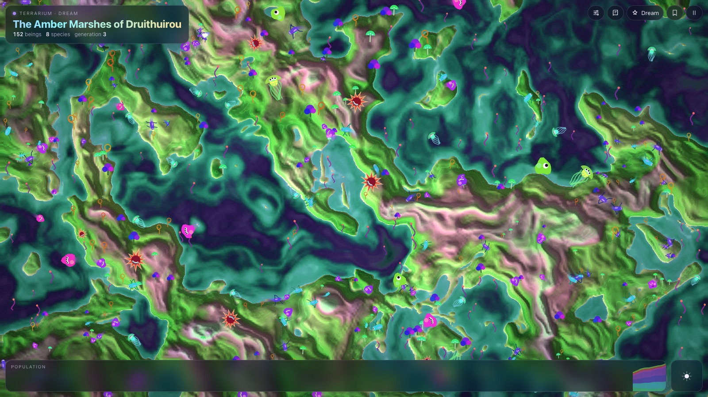
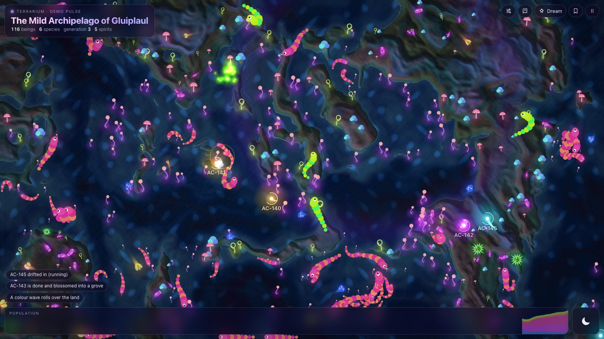
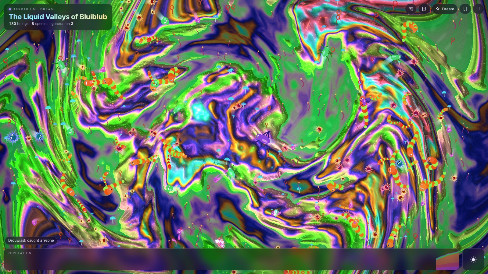
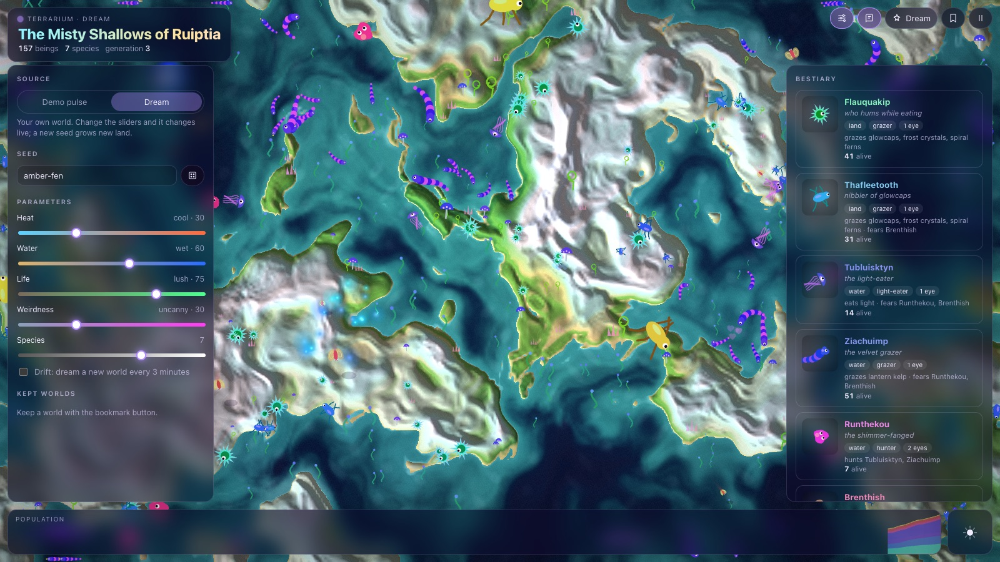

<div align="center">

# 🌀 Terrarium for Agent Control

**A living, slightly psychedelic world that grows from your workspace.**
Busy agents warm it up, deliveries make it teem with life, failures and debates make it weird.
Running tasks drift through it as glowing spirits.

[**Try the demo →**](https://remcoeijsackers.github.io/agent-control-terrarium/) &nbsp;·&nbsp; a plugin for [Agent Control](https://github.com/remcoeijsackers/agent-control)



</div>

## What it is

The Terrarium paints a world from five simple parameters, fills it with made-up flora and creatures, and lets them live:
grazers eat flora, hunters chase grazers, drifters live on light, everything breeds, ages and dies, and extinct species
come back as migrants. Every world is seeded, so the same seed and parameters always grow the same land, the same
species and the same names.

| Parameter | 0 | 1 |
|---|---|---|
| **Heat** | frozen tundra, ice-blue seas | scorched deserts, jungles, warm palettes |
| **Water** | dunes and salt flats | archipelagos, then an endless sea |
| **Life** | barren, a few hardy beings | teeming, flora everywhere |
| **Weirdness** | a sober nature documentary | contour lines pulse, colours melt, the land swirls into a kaleidoscope |
| **Species** | 3 | 9, with a food web of grazers, hunters and apex hunters |

<table>
<tr>
<td width="50%"></td>
<td width="50%"></td>
</tr>
<tr>
<td><sub><b>Night falls</b> every two and a half minutes: the kelp lights up, creatures glow, and the spirits of running tasks leave comet trails.</sub></td>
<td><sub><b>Weirdness 95%.</b> The land swirls, the palette melts and colour waves roll over everything.</sub></td>
</tr>
</table>

## Your workspace's world

In Agent Control the Terrarium follows the last 7 days of the workspace (the window is a setting):

- **Heat** comes from how busy the agents were: tasks created and runs finished.
- **Water** comes from how smoothly it went. Few failures make calm, wide seas.
- **Life** comes from what was delivered.
- **Weirdness** comes from failures and agents debating on the team board, plus the *Extra trippiness* setting.
- **Species** grows with the amount of work: more tasks, more kinds of creatures.

The world changes gently as the pulse moves (every 15 seconds): seas rise and fall, the climate shifts, species that no
longer fit fade out and newcomers migrate in.

**Spirits** are the tasks that are running (cyan), waiting for you (amber, pulsing rings), ready for review (violet) or
merging (green). They make flora grow faster where they pass. Click a spirit to open its task. When a task is done its
spirit blossoms into a grove with a golden burst; when it fails it crumbles to dust.

The plugin only stores task ids, codes and statuses, never titles, prompts or board messages.

## Dream mode

Switch the source to **Dream** to set the five sliders yourself. Heat, water, life and weirdness change the world live;
a new seed grows new land. **Drift** dreams a new world every 3 minutes, which makes a nice second screen.



- **Bestiary** (<kbd>B</kbd>): every species with an animated portrait, its diet, what it fears and how many are alive.
  Click one to follow it on the map.
- **Keep** a world with the bookmark button. Kept worlds are stored per workspace.
- Click a creature to see what it is doing, or click empty ground to plant flora.
- <kbd>Space</kbd> pauses, <kbd>N</kbd> dreams a new world, <kbd>C</kbd> opens the controls.

## For agents

Two tools, offered to agents in workspaces where the plugin is on:

- **`terrarium_dream_world`**: dream up a world (name, seed, the five parameters and a line of lore, all optional) and
  keep it in the workspace's gallery, marked *agent*. Returns the world's field guide.
- **`terrarium_describe_terrarium`**: what the workspace's world looks like right now, what shaped it, and how many tasks
  drift through it.

A field guide reads like this:

```
The Verdant Isles of Plagrozzquymp
A temperate world, mostly sea. Life is lively, and the place feels sober and natural.
Flora: glowcaps, bulb trees, spiral ferns, lantern kelp.
Species:
- Voshyp, who hums while eating: a land gloop with 2 eyes; grazes on glowcaps and bulb trees; hunted by Plixgreesk.
- Plixgreesk, the shimmer-fanged: an air flutterling with 1 eye; hunts Voshyp.
…
```

## Install

In Agent Control: **Plugins → Browse**, find **Terrarium** and click **Install**. Then turn it on under
**Plugins → Installed** for the workspaces you want, and open the **Terrarium** tab.

Or install it from a folder: `POST /api/plugins/install {"path": "/path/to/agent-control-terrarium"}`, or
`{"github": "remcoeijsackers/agent-control-terrarium"}`.

Settings per workspace: **Extra trippiness** (0–1), **Pulse window** (1–30 days) and **Open in** (your workspace's world
or Dream mode with drift).

Plugin pages run in a sandboxed frame. The browser pane of the Claude app refuses those; open Agent Control in Chrome,
Safari or Firefox to see the Terrarium there.

## How it is built

```
manifest.json              permissions db, routes, tools, events, settings; the Terrarium tab; two agent tools
index.mjs                  events → a small activity log; GET /pulse, GET|POST /worlds, DELETE /worlds/:id; the tools
lib/genesis.mjs            the seeded world generator: names, flora, species, food web, palette, field guide
lib/pulse.mjs              workspace activity → the five parameters, and the words that explain them
migrations/001_terrarium.sql
ui-src/page.html           the page shell and HUD styles
ui-src/app.js              terrain (WebGL), the ecosystem simulation (2D canvas), the HUD and the bridge
ui/index.html              built by `npm run build`: one self-contained file, because sandboxed pages can't load others
```

- **Terrain**: domain-warped fractal noise, a sea level chosen as a height quantile (so *water* is literally the share of
  sea), temperature from heat, latitude and altitude, then a fragment shader that mixes natural biomes with a seeded
  cosine palette as weirdness rises, adds hillshading, caustics, shore foam, pulsing contour lines, a breathing warp,
  a kaleidoscope swirl above 80% weirdness, colour waves, day and night.
- **Ecosystem**: a few hundred agents on a spatial hash. Each one senses, flees, grazes or hunts, flocks if social,
  stays in its habitat, spends energy, breeds with small colour mutations (watch generations drift) and dies.
- The page talks to Agent Control only through the [plugin bridge](https://github.com/remcoeijsackers/agent-control/blob/main/docs/plugin-sdk.md#pages):
  it asks for this plugin's own routes, follows the dashboard's light/dark theme and font, and can ask for a taller frame.
  Opened on its own it runs a demo pulse with pretend agents; add `?seed=…&heat=…&water=…&life=…&weird=…&species=…` for a
  specific world, or `?time=75` to start at night.

```bash
npm run build   # ui-src + lib/genesis.mjs → ui/index.html
npm test        # checks the build is current, then the generator, the pulse and the plugin against SQLite
```

The tests run the plugin against a real SQLite database with the same table sandbox Agent Control enforces.

## License

MIT
